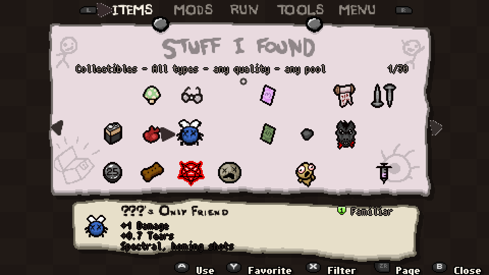

# Isaac Switch Mods

Popular PC mods for **The Binding of Isaac: Repentance on Nintendo Switch**,
rebuilt to run natively on the console, with an in-game mod menu in the style
of the game's own menus.

> Fan project, not affiliated with Nicalis or Edmund McMillen. Requires a
> Switch running custom firmware (Atmosphère). Use at your own risk.

## What you get

| Mod | What it does |
| --- | --- |
| **External Item Descriptions** | Descriptions above items, pickups, trinkets, cards and pills; hold Map to browse your items. |
| **Enhanced Boss Bars** | The PC mod's improved boss health bars; turn it off for the original bars. |
| **Planetarium Chance** | Shows your Planetarium chance beside your other stats. |
| **Regret Pedestals** | Briefly shows the item that vanished when you took one of several choices. |
| **Time Machine** | Hold toward a slot machine or beggar and it runs much faster. |
| **Machine Lock** | Keeps Isaac in place on the machine while Time Machine runs. |
| **Greed Machine Never Jams** | The Greed donation machine never jams. |
| **Hit Counter** | Counts the hits you take this run and this floor; movable and resizable. |
| **Instant Fires and Poops** | In cleared rooms, ordinary fires and poops break in one hit. |
| **The Specialist for Good Items** | Isaac dances to the Specialist music while a top-quality item is in the room. |
| **Animated Items** | Moving artwork for 98 items. |
| **Unique Birthright Sprites** | A different Birthright picture for every character. |
| **Clean Minimap** | Hides the small map's frame. |
| **Repentance+ Rules** | Like the PC Repentance+ update: once The Void is unlocked, a Void portal always appears after ???, The Lamb, Mega Satan and Mother (after you've seen her ending); a Boss Rush wave counter. Each rule can be turned off. |

Plus the **mod menu**:
- **Items:** spawn or give any item, trinket, card, pill or pickup, with search, filters and favourites.
- **Mods:** turn each mod on or off, with per-mod settings.
- **Run:** your seed, stats and item history.
- **Tools:** health, consumables, map reveal, reroll.
- **Menu:** the menu's own settings.

Your choices are saved.

Optional extra: the **Repentance+ balance changes** (item buffs and nerfs from
the PC Repentance+ update), as a separate download.

## Requirements

- A Nintendo Switch with **Atmosphère** custom firmware.
- **The Binding of Isaac: Afterbirth+** with the **Repentance** DLC, updated to
  the latest version (**1.7.9b**).
- A way to copy files to the SD card (card reader, or MTP via DBI/Hekate).

Other game versions are safe: every mod checks the game's code first and
simply stays off if it does not match.

## Install (2 minutes)

1. Download **`IsaacSwitchMods-vX.Y.Z.zip`** from the
   [latest release](../../releases/latest).
2. Unzip it. You get an `atmosphere` folder.
3. Copy that `atmosphere` folder to the **root of your SD card** and merge it
   with the one already there.
4. Start Isaac.

Using **SaltyNX** (FPSLocker, ReverseNX)? Also add the line `X010021C000B6A000`
to `SaltySD/exceptions.txt`, or the mods will not load.

**Optional balance changes:** also unzip
`IsaacSwitchMods-vX.Y.Z-balance-addon.zip` and copy its `atmosphere` folder
the same way. Start a new run afterwards.

Full guide with pictures, uninstalling and troubleshooting: [INSTALL.md](INSTALL.md).

## Using the mod menu

| Where | How to open |
| --- | --- |
| Pause screen | Press **Y** |
| During play (cleared room) | Hold **both stick buttons + D-pad Down** for 2 seconds |
| Main menu → Mods | Press **X** |

**L / R** change page, **A** selects, **Y** opens a mod's settings or marks a
favourite, **X** opens the item filter, **RS** searches items, **LS** shows
more of a long description, **B** goes back, **+** closes.
See [docs/mod-menu.md](docs/mod-menu.md).

## Credits

These are ports of other people's mods. All credit for the ideas, text and
artwork goes to their authors; see [THIRD_PARTY_NOTICES.md](THIRD_PARTY_NOTICES.md).

- External Item Descriptions and Enhanced Boss Bars: **Wofsauge** and contributors
- Planetarium Chance: **Sectimus**
- Regret Pedestals: **seanstertm**
- The Specialist for Good Items: **Jiftoo** and **Devector**
  ([Workshop 2575911103](https://steamcommunity.com/sharedfiles/filedetails/?id=2575911103))
- [Animated Items](https://steamcommunity.com/sharedfiles/filedetails/?id=2570913695),
  [Unique Birthrights](https://steamcommunity.com/sharedfiles/filedetails/?id=2690434875) and
  [Instant Fires and Poops](https://steamcommunity.com/sharedfiles/filedetails/?id=2833146105):
  their Steam Workshop authors
- Native loader: [exlaunch](https://github.com/shadowninja108/exlaunch) by **shadowninja108**

**Original authors:** if you would like your work credited differently or
removed, please [open an issue](../../issues). It will be handled right away.

## Building from source

See [docs/building.md](docs/building.md). Players do not need to build anything.

## License

The code in this repository is released under the GNU GPL v3 (see
[LICENSE](LICENSE)); the exlaunch loader keeps its own license in
`native/LICENSE`. Third-party descriptions and artwork belong to their authors
(see [THIRD_PARTY_NOTICES.md](THIRD_PARTY_NOTICES.md)). The Binding of Isaac
is © Nicalis and Edmund McMillen; no game files are included.
